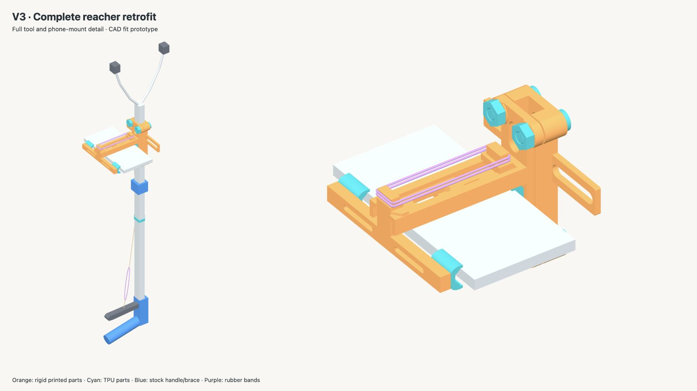
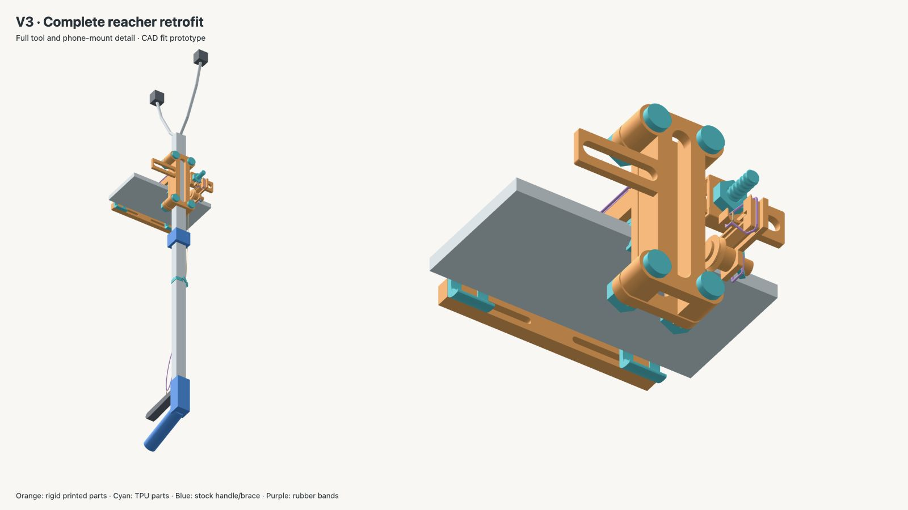

# Too Much Trash

**Every piece of litter is a chance to teach a robot how to help.**

Too Much Trash aims to build a dataset of real-world litter pickup attempts for robotics research. A 3D-printed attachment mounts an iPhone to a reacher grabber, capturing the view from the claw; a mechanical link marks each squeeze in a rolling video buffer. These examples can support perception and imitation-learning research without modifying the grabber's internals or adding electronics.

## The Mechanical Low Cost Attachment

A lightweight, 3D-printed attachment holds a phone beside the grabber with three interchangeable flexible cuffs. A string-driven plunger and redirect pulley operate the phone's volume button, while rubber bands provide return and compliance.

The aspiration is simple: make it easier to gather honest examples of litter pickup at scale, learn from the awkward attempts as well as the clean ones, and help future robots do more of the work of keeping shared spaces clean.
