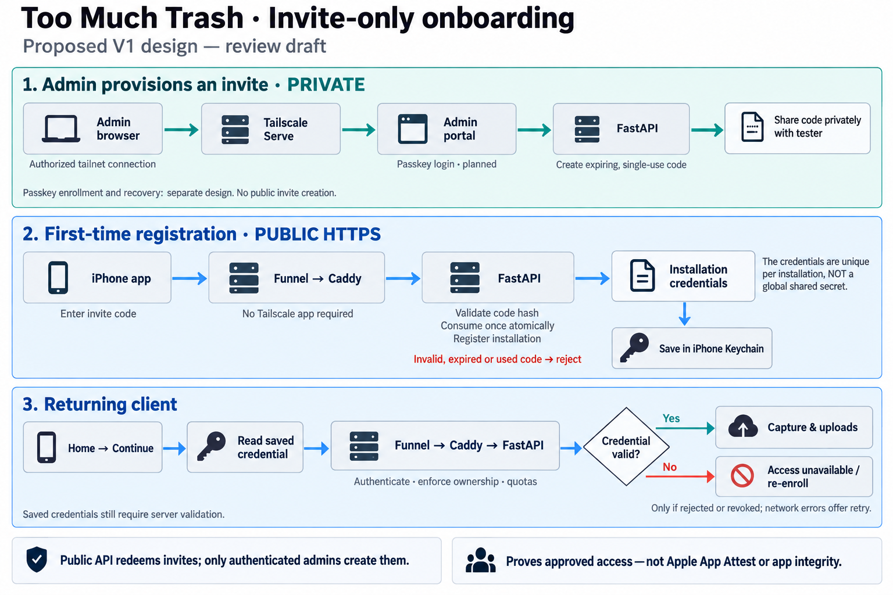

# Invite-only onboarding — V1

Approved design, October 9, 2026. This is our own API authorization, **not Apple
App Attest** or a substitute for Apple's app signing/provisioning requirements.



## Trust boundaries

Collectors need no Tailscale client. They redeem an administrator-issued code
through the public API and store installation credentials in iOS Keychain.
The public Caddy listener rejects every `/api/v1/admin/*` route. The private
admin listener serves the portal and proxies admin endpoints to the same API
service. API containers must never be published directly.

The portal currently uses the existing **temporary shared admin token**, not a
passkey. Tailnet access is an additional gate, not administrator authentication.
Passkey enrollment, recovery and production admin identity remain separate work.
All hosted credential traffic requires HTTPS. Codes and credentials must never
appear in URLs, analytics, logs, UserDefaults, or committed configuration.

## Client contract

| Request | Body / authorization | Result |
| --- | --- | --- |
| `POST /api/v1/auth/enroll` | `invite_code`, optional `installation_name` (1–80 characters; default `iPhone`) | HTTP 201: `installation_id`, `access_token`, `refresh_token`, `token_type: Bearer`, `expires_in: 900`, `refresh_expires_in: 2592000` |
| `POST /api/v1/auth/token` | `refresh_token` | New access token, `token_type: Bearer`, `expires_in: 900` |
| `GET /api/v1/auth/me` | Bearer access token | Installation ID/name, quota and used byte/upload counts |
| `POST /api/v1/media` | Bearer access token; multipart field `file` | HTTP 202 upload receipt |
| `GET /api/v1/media/{id}` | Bearer access token | Owner-only status and receipt |
| `GET /api/v1/media/{id}/{original,processed}` | Bearer access token | Owner-only asset; processed asset available after processing |

Invite redemption is transactional and single-use, including concurrent
requests. Codes and tokens contain at least 256 bits of randomness; only hashes
are stored. Access expires after 15 minutes. Refresh credentials have a fixed
30-day lifetime and are reusable rather than rotated on each refresh. Revoking
an installation disables both immediately. A stolen refresh credential remains
usable until expiry or revocation; this scheme does not attest app identity.

Do not automatically retry enrollment: a lost successful response consumes the
invite. Ask the administrator to revoke the resulting installation and issue a
new invite. Uploads likewise have no idempotency key: a lost acceptance response
may create a duplicate on explicit retry. Warn users rather than silently retry.

Receipts contain `id`, `status`, `filename`, `content_type`, `size_bytes`, `result`,
`error`, `status_url`, `original_url`, and `processed_url`. URLs are relative;
pending result/error/processed URL fields can be null. Status is `queued`,
`processing`, `completed`, or `failed`. The current worker creates previews/poster
frames, **not SAM3 masks**. Originals survive processing failures.

## Errors and client behavior

API errors normally use `{ "detail": { "code": "…", "message": "…" } }`.

| Status / code | Client action |
| --- | --- |
| 400 `invite_invalid` | Code is unknown, expired, used, or revoked; deliberately indistinguishable |
| 401 `access_invalid` | Refresh once, then retry the authenticated request once |
| 401 `access_revoked` | Do not refresh; show revoked access |
| 401 `refresh_invalid` | Re-enrollment required |
| 429 `rate_limited` | Respect `Retry-After`; no retry loop |
| 429 `quota_exceeded` | Retain local media and ask administrator for help |
| 413 `upload_too_large` | File exceeds 200 MiB or request exceeds proxy limit |
| 415 `media_type_unsupported` / 400 `upload_empty` | Explain invalid media; keep local original |
| 404 `media_not_found` | Missing and another installation's assets look identical |
| 404 `media_not_ready` | Processed asset not available yet |

FastAPI validation errors can have a 422 detail array; proxy failures may not be
JSON. Clients need a generic fallback. Network failures are not revoked access:
retain credentials and the local queue. Bind queued clips and receipts to the
normalized API origin **and installation ID**; never silently reassign them to a
new server or identity. Refuse redirects on credential-bearing requests.

## Administrator operations

The portal unlocks using the development admin token. Mutations require the
session cookie plus `X-TMT-Admin: 1`; no cross-origin API access is enabled.

* `POST /api/v1/admin/invites`: label, `expires_in_hours` (1–168, default 24),
  `quota_bytes` (default 1 GiB), and `quota_uploads` (default 100). Returns the
  invite code **once**. Losing it requires another invite.
* `GET /api/v1/admin/invites` and `/installations`: most recent 200 records;
  never return credential hashes or secrets.
* `POST /api/v1/admin/invites/{id}/revoke`: prevents future redemption. Does
  **not** revoke an already enrolled installation.
* `POST /api/v1/admin/installations/{id}/revoke`: disables installed credentials.

`GET /api/v1/admin/reachability` is private-only and returns
`{"service":"too-much-trash-admin","version":1}` without an admin session.
The iPhone shows Admin only after an HTTPS probe to the configured private origin
returns that exact identity without redirects, then opens its root in the system
browser. Recheck on foreground and before opening. This is a UX visibility test,
not proof of administrator authority or a substitute for server access control.

## Abuse limits and remaining risks

Database-backed global fixed-window limits: 60 enrollments, 120 refreshes, and
20 admin login attempts per minute. Caddy caps public requests at 201 MiB and
auth bodies at 16 KiB. Upload authorization precedes multipart parsing in the
API. Installation quotas count lifetime original bytes and accepted uploads;
database locks prevent concurrent overrun. Failed processing still counts.

These controls are for an invite-only prototype, **not DDoS protection**. Global
limits can be exhausted by an outsider. Before broader rollout, add trusted
proxy-aware per-client controls, monitoring and edge protections. Derivatives,
worker compute and retained database records are not included in storage quotas.
Legacy captures without installation ownership remain stored but inaccessible to
collector credentials; do not guess ownership or delete them.

## Optional Tailscale deployment

Local listeners bind to localhost. The optional `compose.tailscale.yaml` overlay
removes host port publishing, shares Caddy's network namespace with a userspace
Tailscale node, persists node state, and enables secure admin cookies. Pin a
reviewed Tailscale image version before deployment. It is not activated by default.

Proposed HTTPS ports on the node's `*.ts.net` hostname:

| Port | Route | Intended exposure |
| --- | --- | --- |
| 443 | Public website | Funnel, only after explicit activation |
| 8443 | Admin portal | Serve / tailnet only; **never Funnel** |
| 10000 | Collector API | Funnel, only after explicit activation |

The checked-in serve configuration has **all `AllowFunnel` values false**.
An operator must authenticate the node, configure tailnet grants/HTTPS/Funnel
permissions, and approve activation. No account changes, login or exposure were
performed during implementation. Only 443 and 10000 may later be made public.
Directory-mounted configuration follows [Tailscale's container parameters](https://tailscale.com/docs/features/containers/docker/docker-params).

Validate configuration before using the overlay:

```sh
docker compose -f compose.yaml -f compose.tailscale.yaml config --quiet
```

Back up existing Postgres data before deploying schema changes. The `migrate`
service runs `uv run --no-sync alembic upgrade head` under a database advisory lock and runs
before the API starts, including for an existing volume. Initialization scripts
alone do not update an existing database. Rebuild/redeploy to activate these
changes; editing source does not secure an already-running old container.

Alembic tracks applied revisions in `alembic_version`; repeated upgrades are
no-ops. Keep at most one new revision file per PR. This PR has one revision,
`backend/api/migrations/versions/003_onboarding.py`, adopting the existing pilot
schema without discarding records. The two `postgres/init` SQL files are initial
database setup, not Alembic revisions. Do not stamp a live database without schema
verification. Downgrade removes authentication/ownership records and requires an
explicit recovery plan and backup; it is never part of normal deployment.

Eric will review and test the Simulator app first. Personal iPhone installation
and physical camera/volume-button validation follow that review, not before it.

Backend regression tests use an isolated disposable Postgres database with
`TMT_TEST_ISOLATED=1`, `DATABASE_URL`, and `S3_BUCKET` set. Blob storage is mocked;
run `python -m unittest discover -s tests -v` with API dependencies and `httpx`
installed. They never validate real Apple services or a live Tailscale deployment.

### Verification — October 9, 2026

* 11 API/Postgres integration tests passed; blob storage was mocked.
* 3 checks against an isolated Caddy/API stack passed: public admin isolation,
  private probe versus session authorization, and auth body limits/upload denial.
  Set `TMT_PROXY_TEST_PUBLIC` and `TMT_PROXY_TEST_PRIVATE` to disposable proxy
  origins to run `test_proxy.py`; otherwise those checks skip.
* Actual migration runner applied the migration twice successfully.
* Compose overlay and Caddy configuration validated; frontend TypeScript and
  production build passed. Patched build dependency audit: zero vulnerabilities.
* Admin browser unlock, invitation creation and one-time code dismissal verified
  with disposable credentials and data. The existing running stack was untouched.

### Local deployment — October 10, 2026

The iPhone checkpoint `7d87aeb` was integrated as `a074293`. Before deployment,
a verified Postgres custom-format backup was saved to the ignored, owner-only
`backend/.backups/pre-onboarding-20261010.dump`. The old checkout's admin secret
was unavailable; with explicit approval, a replacement temporary token was saved
privately to `backend/.secrets/admin-token`. Existing database/storage configuration
was preserved in the ignored, owner-only `backend/.env` without displaying values.

API, migration and Caddy images rebuilt successfully. Migration exited zero;
only API/Caddy were replaced, leaving database and media volumes intact. All
published listeners now bind to localhost. The optional Tailscale overlay was
validated but not activated; no Funnel, public HTTPS, passkeys, push or merge.

The live local smoke test passed: public admin isolation, private probe/session
separation, replacement admin login, single-use enrollment, access/refresh,
real blob byte roundtrip, worker processing and derivative retrieval, owner-only
status/downloads, quotas, and revoked access/refresh. Two labelled revoked test
installations and one tiny test image remain as audit records; no real captures
were removed. Physical iPhone testing still requires configured HTTPS origins
and device signing; do not weaken the app's HTTPS-only checks for localhost HTTP.

### Private HTTPS pilot — October 10, 2026

After explicit approval, the laptop's existing macOS Tailscale node was used for
two background Serve proxies: HTTPS port 10000 to Caddy's localhost 8082 collector
listener, and HTTPS port 8443 to localhost 8081 admin listener. The Docker
Tailscale overlay remains inactive. The actual Serve configuration contains only
these two private routes and no Funnel entries. Admin cookies now require HTTPS.

All three proxy checks passed through the actual node FQDN with normal TLS
certificate validation. The complete invite/media/worker/ownership/quota/refresh/
revocation smoke test also passed over HTTPS; two additional revoked labelled
test installations and one tiny image remain as audit records. Initial automatic
certificate provisioning exceeded one probe's timeout; the subsequent checks
passed without TLS exceptions. The verified origins were sent to the Iphone Agent
for Simulator checks. Physical iPhone validation remains separate.

For this private pilot, use the laptop's full MagicDNS FQDN from `tailscale status`
with port 10000 as collector origin and port 8443 as admin origin. Do not use the
bare `mongoose-bonito.ts.net` tailnet suffix as a service hostname. To disable
only these proxies later: `tailscale serve --https=10000 off` and
`tailscale serve --https=8443 off`. Do not run a global Serve reset when other
services may have been added.

The planned Mac mini deployment will have its own node FQDN and Serve setup.
Client origins are configurable; old origin/installation-bound queued clips must
not be silently adopted during that migration. HTTPS certificate renewal and
reachability depend on Tailscale and the host remaining operational.

With explicit approval, a one-hour, 1 MiB / one-upload invite was issued for
native Simulator integration. The real iOS registration flow passed over verified
HTTPS, stored credentials in Keychain, authorized `/auth/me`, and a fresh app
session reused the same installation from Keychain. The private admin probe
passed and normal app relaunch reached Field Camera. No upload was attempted;
Simulator camera availability is not physical capture validation. The exact test
installation was then revoked through the private admin API.
Normal app relaunch correctly rejected the revoked saved access and did not
enter capture. Disposable invite fixtures and the temporary live test harness
were removed; the small Home configuration fix and permanent regression test
were integrated locally. Live iOS upload and physical camera/volume-button
validation remain outstanding.

### Alembic adoption — October 11, 2026

Replaced the custom SQL runner with Alembic 1.20.0, one onboarding revision and
standard `alembic_version` bookkeeping. Twelve disposable-Postgres migration/API
tests passed, covering initialized fresh databases, adoption of the legacy pilot,
preserved invite/installation/capture records, repeat upgrade, and disposable-only
downgrade/re-upgrade. Three private HTTPS proxy checks passed after deployment.
The local database was backed up before adoption; the revision is `003_onboarding`
and counts remained four captures, five invites, five installations and one access
token. A second live upgrade was a successful no-op. No live downgrade or new
invitation was performed; test-container removal did not affect live volumes.
